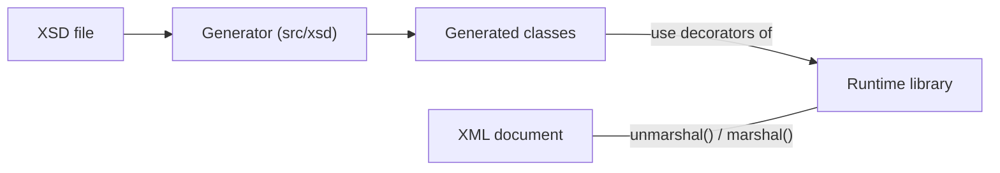

# Purpose

`@neumaennl/xmlbind-ts` binds XML documents to TypeScript classes in the style of JAXB: decorators describe how the fields of a class map to XML, `unmarshal()` creates an object from an XML string, and `marshal()` writes an object back to XML. The `xsd2ts` generator writes such decorated classes from an XML Schema (XSD).

This document describes how the package is structured. The other documents describe the parts in detail: the [decorators](decorators.md), [marshalling and unmarshalling](marshalling.md) and the [code generation](code-generation.md).

# Scope

xmlbind-ts is responsible for what every application that binds XML needs, whatever the format of its documents. What needs the rules of a particular format, or of the environment the application runs in, belongs to the application. As a rule of thumb: if an application that binds a completely different XML format would need it as well, it belongs in xmlbind-ts.

| Concern | Owner | Why |
|---|---|---|
| Parsing and writing XML, and the choice of the libraries that do it | xmlbind-ts | Every application needs it. |
| Decorators, the generator, and the conversion of values to the type of their field | xmlbind-ts | Generic binding mechanics. |
| Keeping the source of a document on a round trip: the order of the child elements, comments, processing instructions, namespace declarations and prefixes, attribute order, quotes, empty-element style and indentation | xmlbind-ts | Every application that writes a document back needs it. |
| Keeping content that no field maps | xmlbind-ts | The same. |
| Telling the caller what a round trip drops or changes | xmlbind-ts | Only xmlbind-ts sees it. These are facts, not decisions. |
| Testing round trips with real documents | xmlbind-ts | It owns the round trip. |
| What to do with a document that does not survive a round trip unchanged: warn, refuse to write it, or accept the loss | Application | A product decision. |
| Validating a document against its schema, and the meaning of values beyond the type of their field, such as resolving a QName to the component it names | Application | Needs the rules of the format. |
| Which schema the classes are generated from, and keeping them up to date | Application | Only the application knows its format. |

xmlbind-ts does not do all of its part yet: [Marshalling](marshalling.md#what-a-round-trip-keeps-and-changes) describes what a round trip keeps and changes today, and [Known issues](known-issues.md) lists the gaps.

The generator is the only part that knows XSD: it reads a schema to write classes. The runtime library does not depend on XSD; the classes the generator writes are ordinary decorated classes.

# Two parts in one package

The package contains two parts that share no code at runtime:

- **The runtime library** (`src/decorators`, `src/metadata`, `src/marshalling`, `src/util`, `src/types.ts`) records the mapping that the decorators describe and converts between objects and XML.
- **The generator** (`src/xsd`) reads an XSD and writes TypeScript classes that use the decorators of the runtime library. It is used through the `xsd2ts` command or through `generateFromXsd()`.

The generated classes import the decorators from `@neumaennl/xmlbind-ts`, so an application that uses them needs the package at runtime, but not the generator.[^writer]

## Modules

| Folder | Content |
|---|---|
| `src/decorators` | One file per decorator: `@XmlRoot`, `@XmlElement`, `@XmlAttribute`, `@XmlText`, `@XmlEnum`, `@XmlAnyElement`, `@XmlAnyAttribute`; `fieldType.ts` resolves the type of a field for `@XmlElement`, `@XmlAttribute` and `@XmlText`. |
| `src/metadata` | The metadata registry, which stores the mapping of each class. |
| `src/marshalling` | `marshal()` and `unmarshal()`, with helpers for namespaces, element order, comments, the decoding of entities, the escaping of values, and the tree that `marshal()` writes with `fast-xml-builder`. |
| `src/util` | Value casting, resolution of lazy type references, and namespace helpers, shared by the decorators and the marshalling. |
| `src/types.ts` | The metadata types `ClassMeta` and `FieldMeta`, and `Constructor`. |
| `src/xsd` | The generator: the XSD parser, `generateFromXsd()`, the command line interface and the cleanup of the output folder. |
| `src/xsd/tsgen` | The steps of the generator: indexing the schema, simple types and enums, classes, elements, attributes, references, and writing the files. |

# Public API

The package has one entry point, `@neumaennl/xmlbind-ts`, compiled from `src/index.ts`, and the command `xsd2ts`.[^manifest] The entry point exports:[^entry]

- the seven decorators;
- `marshal()` and `unmarshal()`;
- from the metadata registry: `getMeta()`, `ensureMeta()`, `getAllFields()`, `allMeta()` and the map `META`. The registry's helpers for Stage 3 decorators are internal and are not exported;
- `generateFromXsd()`.

Everything else is internal, even when it is exported from its own module. This includes the types `ClassMeta`, `FieldMeta` and `Constructor`, although `getMeta()` and `getAllFields()` return them, and `allMeta()` always returns an empty array, because the registry is a `WeakMap` that cannot be iterated.[^registry]

Because the entry point exports `generateFromXsd()`, importing the package also loads the generator, `@xmldom/xmldom` and Node's `fs`.[^generator] The package supports Node.js only (`engines.node`); building it for a browser needs a bundler that removes or replaces these modules.

# Dependencies

| Package | Used by | Purpose |
|---|---|---|
| `fast-xml-parser` | Runtime library | Parses XML in `unmarshal()`. |
| `@nodable/entities` | Runtime library | Decodes entities and character references while `fast-xml-parser` parses. |
| `is-unsafe` | Runtime library | Detects unsafe values of entities that a DOCTYPE declares, so that they are not expanded. |
| `fast-xml-builder` | Runtime library | Writes XML in `marshal()`, in its ordered mode. |
| `reflect-metadata` | Runtime library | Reads the `design:type` metadata of legacy decorators in `@XmlElement`, `@XmlAttribute` and `@XmlText`. |
| `@xmldom/xmldom` | Generator | Parses the XSD into a DOM. |
| `commander` | Generator | Parses the arguments of `xsd2ts`. |

All seven are runtime dependencies of the package, including those that only the generator needs.[^manifest]

# Principles

- **Metadata belongs to the class.** The decorators record the mapping in a registry, keyed by the class constructor. `marshal()` and `unmarshal()` read it, including the fields inherited from base classes. The registry is a `WeakMap` stored on `globalThis` under `Symbol.for("@neumaennl/xmlbind-ts/META")`, so that several copies of the package in one process share it.[^registry] [Decorators](decorators.md) describes how legacy and Stage 3 decorators reach the registry.
- **The classes stay plain.** Decorated classes need no base class and no interface. `unmarshal()` creates instances with `new` and no arguments, so a class needs a constructor that can be called without arguments.[^unmarshal]
- **Unmarshalled objects remember the source.** To write a document back as it was read, `unmarshal()` stores information about the source on the objects it creates, in properties whose names start with an underscore: the namespace declarations of the root, the XML declaration, comments and the order of the child elements.[^unmarshal] `marshal()` uses them when they are present.[^marshal] [Marshalling](marshalling.md) describes what a round trip keeps and what it changes.
- **Synchronous and string-based.** `marshal()` and `unmarshal()` work on complete strings, without streams or callbacks.
- **The generator writes source code.** `xsd2ts` writes TypeScript files that the application compiles together with its own code; it does not create classes at runtime.[^cli]

[^entry]: Package entry point

[^manifest]: Package manifest

[^registry]: Metadata registry

[^unmarshal]: Unmarshalling

[^marshal]: Marshalling

[^generator]: Entry point of the generator

[^cli]: xsd2ts command line interface

[^writer]: Writer of the generated files
