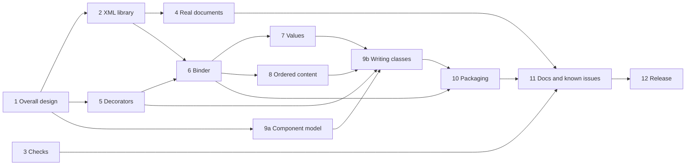

# ADR 001: Reimplementation of xmlbind-ts as version 3

**Status:** Accepted  
**Date:** 2026-11-13  
**Issue:** [#300](https://github.com/neumaennl/xmlbind-ts/issues/300)

## Context

Version 2.x binds XML to decorated classes and generates such classes from an XSD. Its [known issues](https://github.com/neumaennl/xmlbind-ts/blob/2.4.0/docs/known-issues.md) list many problems.[^known-issues-240] Most of them appear on a round trip: elements and comments move, namespace declarations and whitespace get lost, and values change their form.

The analysis made while fixing [#296](https://github.com/neumaennl/xmlbind-ts/issues/296) found six root causes behind most of these problems:[^issue-299]

1. **No document model.** `unmarshal()` parses every document twice with `fast-xml-parser`. The first result groups the children by name and loses their order. Order and comments are taken from the second result and matched back by paths of local names.
2. **No control over the output.** `marshal()` writes through `fast-xml-builder`, which declares namespaces only on the root and does not check characters.
3. **Positional metadata.** Round-trip information is kept in enumerable `_` properties, such as `_elementOrder` and `_comments`. It gets out of sync as soon as the application changes the data.
4. **A data model without open content.** Repeated choices, mixed content and several elements of the same name in one sequence cannot be expressed.
5. **Values converted by JavaScript.** `Number`, `Boolean` and `Date` convert values instead of the lexical spaces of the XSD types.
6. **No model of schema components.** The generator walks the DOM of the schema and resolves names by their local part.

The root causes depend on each other. Without a document model, the round-trip information has to be kept beside the data, and the output has to be built anew. Every fix of a single known issue has to work around them.

## Decision

xmlbind-ts is reimplemented as version **3.0.0**. 2.4.0 is the last release of 2.x, which gets no more fixes.[^issue-299]

### Project

- Version 3 is developed in this repository, in the branch `reimplementation`. It is merged into `main` and released only when it can replace 2.x.
- It is a reimplementation, not a refactoring of 2.x. The concept stays: decorators record the mapping of classes to XML in metadata, and a generator writes such classes from an XSD. Everything else is designed anew.
- **Breaking changes are expected.** The public API and the generated classes change wherever the design needs it. Only what version 3 needs is reimplemented; features of 2.x that it does not need, such as `allMeta()`, are dropped.
- **Do things properly.** No workaround where a proper solution exists; the effort does not decide.

### Principles

These are the requirements of [#299](https://github.com/neumaennl/xmlbind-ts/issues/299). Every part of version 3 follows them.[^issue-299]

- **Write changes, not the whole document.** A round trip writes only the changed parts. The unchanged parts keep their exact text: quotes, empty-element style, character references, whitespace and indentation ([#252](https://github.com/neumaennl/xmlbind-ts/issues/252)). Writing the whole document stays possible.
- **Changes as text edits.** Besides the complete new text, `marshal()` can return the changes as a list of text edits. Each edit is a range of the source text and the text that replaces it. An application that owns the document, such as an editor or a language server, applies them itself.
- **No file access.** The runtime library works on strings and text edits. It does not read or write files.
- **Standard libraries for XML.** XML is parsed and written with standard-conformant, actively maintained libraries, not with a parser or serializer of our own. Bugs found in them are reported upstream, with a pull request where possible. A temporary workaround until the upstream fix is acceptable, a permanent one is not.
- **Scope** as in the [architecture of 2.4.0](https://github.com/neumaennl/xmlbind-ts/blob/2.4.0/docs/architecture.md#scope):[^architecture-240]
  - xmlbind-ts keeps the source of a document on a round trip.
  - It keeps content that no field maps.
  - It tells the caller what a round trip drops or changes, as facts. What to do about it stays with the application.
- **Platforms.** The runtime library runs in Node.js and in browsers. The generator needs Node.js.
- **The runtime may know XSD.** It knows the lexical spaces of the built-in types and the attributes of the namespace `xsi`. It binds a document by the mapping that the decorators record and does not load a schema for that. A schema is a document like any other, which the runtime binds with classes generated for it.
- **No schema validation.** Validating against the schema stays with the application.
  - `unmarshal()` and `marshal()` report the problems they find while binding, such as a value outside the lexical space of its type. The caller decides whether to stop or continue.
  - An external validator that checks the object tree against its schema can be added later without changing the existing API.
- **Strict namespaces.** `unmarshal()` and `marshal()` match names the same way: a field binds exactly one qualified name.
  - A class can set a default namespace for its fields.
  - A field states its namespace only where it differs from that default.
  - Without either, a field has no namespace.
  - The generator uses the class default.
- **Arrays are never optional.** A field for an element that can occur more than once is always an array, empty if the element does not occur. This holds for unmarshalled objects and for objects created with `new`. The generator declares such fields as non-optional ([#277](https://github.com/neumaennl/xmlbind-ts/issues/277)).
- **Both kinds of decorators.** Legacy decorators (`experimentalDecorators`) and Stage 3 decorators stay supported ([#290](https://github.com/neumaennl/xmlbind-ts/issues/290)). Generated classes load under every supported compiler setup.
- **Known issues are requirements.** Every entry of the [known issues of 2.4.0](https://github.com/neumaennl/xmlbind-ts/blob/2.4.0/docs/known-issues.md) about the library or the generator is handled in one of three ways:[^known-issues-240]
  - impossible by design in version 3;
  - covered by a test;
  - accepted with a reason.

  Entries about parts that are not reimplemented, such as the scripts, the build or CI, are lessons: version 3 must not repeat the mistake. Entries that version 3 makes obsolete are deleted after its release.
- **Real documents.** Round trips are tested with real documents ([#294](https://github.com/neumaennl/xmlbind-ts/issues/294)). Problems found are recorded in the known issues.

### Parts and their order

The work is done in parts. Each part is a sub-issue of #299 and records its decisions as ADRs in this folder.

| Part | Issue | Decides |
|---|---|---|
| 1. Overall design | [#300](https://github.com/neumaennl/xmlbind-ts/issues/300) | this ADR |
| 2. XML library | [#301](https://github.com/neumaennl/xmlbind-ts/issues/301) | which library; how the source ranges are obtained |
| 3. Checks for the new code | [#295](https://github.com/neumaennl/xmlbind-ts/issues/295), [#297](https://github.com/neumaennl/xmlbind-ts/issues/297) | – |
| 4. Round trips of real documents | [#294](https://github.com/neumaennl/xmlbind-ts/issues/294) | – |
| 5. Decorators and metadata | [#302](https://github.com/neumaennl/xmlbind-ts/issues/302) | whether the runtime reads `design:type`; which decorators and options |
| 6. Binder | [#303](https://github.com/neumaennl/xmlbind-ts/issues/303) | how `marshal()` finds the source; matching; comments of removed elements; the form of the text edits and of the report |
| 7. Value conversion | [#304](https://github.com/neumaennl/xmlbind-ts/issues/304) | – |
| 8. Ordered content and polymorphism | [#305](https://github.com/neumaennl/xmlbind-ts/issues/305) | the shape of the items |
| 9a. Generator: component model | [#306](https://github.com/neumaennl/xmlbind-ts/issues/306) | – |
| 9b. Generator: writing the classes | [#307](https://github.com/neumaennl/xmlbind-ts/issues/307) | [#282](https://github.com/neumaennl/xmlbind-ts/issues/282) |
| 10. Packaging | [#308](https://github.com/neumaennl/xmlbind-ts/issues/308) | – |
| 11. Documentation and known issues | [#309](https://github.com/neumaennl/xmlbind-ts/issues/309) | – |
| 12. Release 3.0.0 | [#310](https://github.com/neumaennl/xmlbind-ts/issues/310) | – |

A part starts when the parts it is blocked by are done. Parts without a path between them can run at the same time. Part 3 is blocked by no other part. Part 11 is blocked by parts 1 to 10 and checks that every known issue of 2.4.0 is handled.

An arrow points from a part to the parts that it blocks.

### How the branch starts

The code of 2.x is removed at once, in one commit at the start of the branch.

- **Removed:**
  - the code in `src/`;
  - the tests in `__tests__/` and the test helpers that use the code of 2.x;
  - the runtime dependencies that only the code of 2.x uses;
  - the documents that describe the code of 2.x, and the parts of the other documents that do.
- **Kept:**
  - the project setup: `package.json`, the configurations of TypeScript, ESLint and Vitest, CI, Dependabot and `scripts/`;
  - the test helpers that do not use the code of 2.x, and the test resources in `__tests__/test-resources`;
  - the development guidelines, the testing and build documents as far as they describe the setup, and the known issues.
- **Links** from the remaining documents to removed ones point to their versions at the tag `2.4.0`.
- **README.** `README.md` says that the branch holds version 3 while it is developed and links the documentation of 2.4.0.

Each part then adds its code, its tests and the document that describes its code.

**Tests as a specification.** Each part writes tests for the behavior it implements. The tests follow from the part's ADRs and from the known issues it handles. The tests of 2.x at the tag `2.4.0` are a list of cases to look at, not code to port.

## Reasons

- **Fixing one by one does not reach the goal.** Each known issue of the round trip comes from the root causes. A fix of one issue has to keep the design that causes it, so it replaces one fragile mechanism with a slightly less fragile one. The fixes discussed for #296 showed this (see [Rejected alternatives](#rejected-alternatives)).[^issue-296]
- **The main requirement is impossible in 2.x.** To write only the changes, xmlbind-ts must know where each node of the source is, and which object and field it belongs to. 2.x keeps no source positions and builds the whole output anew.
- **The root causes are tied together.** A document model makes the positional metadata unnecessary. The data model for open content changes the generated classes. The value conversion depends on what the generator knows about the types. Changing one root cause changes the others, so they are designed together.
- **Breaking changes are acceptable.** xmlbind-ts has no known users outside the maintainer's own projects, which migrate to version 3. A major version states the break.
- **Removing 2.x at once** keeps the branch free of two designs:
  - The parts of version 3 do not match the modules of 2.x. For example, the binder on a document model replaces both parsers, the reading of the metadata and the `_` properties together.
  - Mixing old and new code would need adapters between them. Adapters are workarounds that the new design does not need.
  - The generator of 2.x writes decorators that version 3 will not have.
  - The code of 2.x stays available at the tag `2.4.0`, as a reference for cases and for rules that were correct, such as the naming rules of the generator.
- **A branch** lets `main` keep describing the released version until version 3 can replace it.

## Consequences

- The branch has no working package until parts 2 to 10 are done. CI on the branch checks only what exists.
- The tests are written anew. Cases that 2.x tested and version 3 keeps get new tests in the part that implements them.
- Applications that use 2.x have to migrate to the new API of version 3.
- Each part names the known issues of 2.4.0 that it handles. Part 11 checks that every entry is handled.
- The documents of the knowledge bundle describe only what exists on the branch. Each part writes or updates the documents of its code.
- Decisions of the parts are recorded as further ADRs in this folder. They follow the principles of this ADR; where one cannot, this ADR is updated first.

## Rejected alternatives

- **Fix the known issues of 2.x one by one.** The fixes discussed for #296, the order of elements and comments, each kept the positional metadata:[^issue-296]
  - **Anchor each occurrence** in `_elementOrder` by its name and occurrence number. This breaks as soon as the application inserts or removes occurrences. A mapped element and a wildcard element with the same local name in different namespaces would share one numbering.
  - **Clark notation** (`{uri}local`) in `_elementOrder`. `marshal()` would have to repeat the lenient namespace matching that `unmarshal()` applies to fields without a namespace. The known issue "A default namespace declared on a child element is ignored" would still get in the way.[^known-issues-240]
  - **Record the bound field per occurrence.** Better than the other two, but still positional metadata beside the data, which gets out of sync when the application changes it.
- **Refactor 2.x step by step.** Each step would have to keep 2.x working while the design under it changes. The root causes are tied together, so the steps would be large and full of temporary code.
- **Replace 2.x part by part, in place.** See the reasons for removing 2.x at once.
- **Develop version 3 next to 2.x** in a folder of its own until the release. Two implementations would have to be built, linted and tested, although nothing on the branch uses 2.x.
- **A parser or serializer of our own,** or a lexical layer of our own on top of a library. Proven libraries are tested against the XML specification by many users; one of our own would need the same testing and maintenance. Whether a library provides what writing only the changes needs, such as source positions, is decided in part 2 ([#301](https://github.com/neumaennl/xmlbind-ts/issues/301)).

## Review

- **When a part cannot follow a principle,** for example because no library provides the source positions that writing only the changes needs. This ADR is then updated before the part goes on.
- **Before the release of 3.0.0** (part 11): check that the parts fit together and that the principles hold.
- **When the branch is merged into `main`:** remove the sections "Parts and their order" and "How the branch starts", which then describe history. The decision, its principles and its reasons stay.

[^issue-299]: Reimplement xmlbind-ts as version 3 (#299)

[^known-issues-240]: Known issues of version 2.4.0

[^issue-296]: Children that were not in the source are written after all others (#296)

[^architecture-240]: Architecture of version 2.4.0
